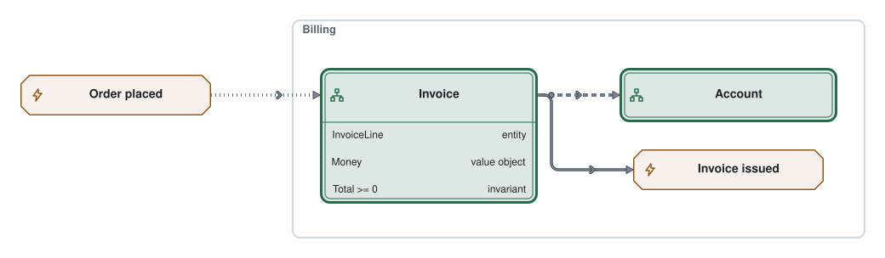
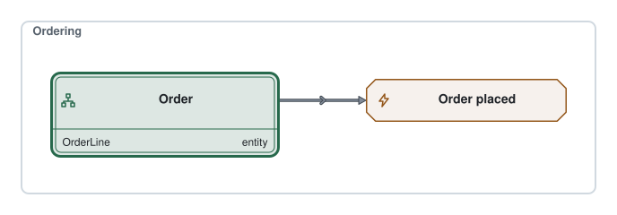

# Example aggregate diagrams

An aggregate diagram draws one bounded context as a Group, with its aggregates and domain events as Nodes. An aggregate stands for its root; its Rows list the entities, value objects and invariants inside it. References between aggregates end at the aggregate Nodes.

Billing's Invoice references an Account and emits an Invoice issued event. The Invoice also reacts to Ordering's Order placed event, drawn outside Billing under its full id, `ordering/order-placed`. The dashed Edge is `references`, the solid one `emits`, and the dotted one `reacts`; each points toward its effect.

Inside Billing, the module writes local ids such as `invoice`, and the builder writes `billing/invoice` into the JSON model. An Edge may use a handle, a local id inside the Group's callback, or a full id for a Node declared elsewhere on the Diagram. Another context's `invoice` would be a different id.

Order placed belongs to Ordering. Its own aggregate diagram draws it inside the Ordering Group, where Order emits it:

The context and event are defined once in [shared/ordering.ts](./shared/ordering.ts). The same context id is a Node on the [context map](./example-context-map.md) and a Group here. The Atlas index records both drawings. Lint warns if a borrowed event has no drawing inside its own context on any Diagram.

The modules are [example-billing.diagram.ts](./example-billing.diagram.ts) and [example-ordering.diagram.ts](./example-ordering.diagram.ts). Render them and commit each with its SVG after editing.
