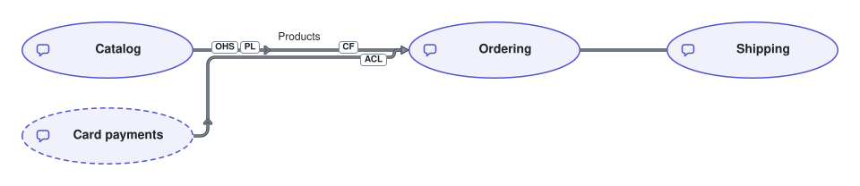

# Example context map

A context map shows bounded contexts and how they relate. Each context is drawn as an oval. This one maps a shop's Catalog, Ordering and Shipping contexts, and the context of a card payments provider. We don't own the provider's context, so the Diagram draws it External, with a dashed outline.

Ordering is downstream of the Catalog and of Card payments: an Edge runs from each upstream context to it, with an arrowhead at Ordering, and chevrons along it that point the same way. The tags on an Edge's line say how the context at that end integrates:

- By the Catalog, `OHS` and `PL`: the Catalog offers an open host service, in a published language.
- By Ordering, `CF` on the Edge from the Catalog: Ordering is a conformist, and takes the Catalog's model as it is.
- By Ordering, `ACL` on the Edge from Card payments: Ordering keeps the provider's model out of its own with an anticorruption layer.

The label on the Edge from the Catalog says what Ordering takes from it.

Ordering and Shipping are partners. A partnership runs both ways alike, so its Edge has no arrowhead and no chevrons. The Catalog and Shipping go separate ways, so no Edge joins them.

The Diagram is written in [`example-context-map.diagram.ts`](./example-context-map.diagram.ts). After editing it, run `pnpm exec diagrams render`, and commit the module and its SVG together.
