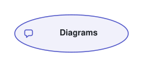

# Glossary term Links

This small context map draws the Diagrams context. Its Node carries Links to Diagram, Atlas and Link in the context's glossary, registered in `diagrams.config.ts`. The SVG keeps those Links in its model for readers to explore; they add no Edges to the drawing.

