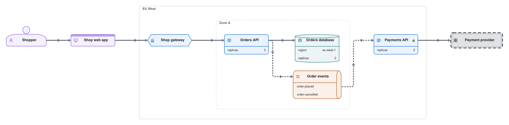

# Example system

A shop's web app calls the shop's gateway, which calls the Orders API. The Orders API stores each order in its database and announces it on the order events queue, which the Payments API listens to.

The Diagram is written in [`example-system.diagram.ts`](./example-system.diagram.ts). After editing it, run `pnpm exec diagrams render`, and commit the module and its SVG together. `diagrams lint`, which the pre-commit hook runs, fails when the SVG no longer matches its source.
