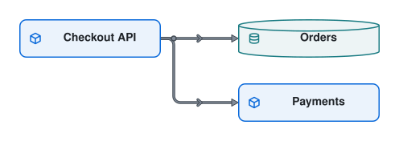

# A checkout Walkthrough

On the docs site, choose **Place an order** to play four Steps: save an order, return its id along the same Edge, save and charge in parallel, then highlight the Checkout API. The source is [example-walkthrough.diagram.ts](./example-walkthrough.diagram.ts).

**Pause** stops playback. **Next Step** and **Previous Step** move one Step and pause. Right or Down advances, Left or Up goes back, and Escape returns to the list. At the end, **Play** starts again. Each Step shows its note and number. Reduced motion, or the host's `motion="off"`, makes highlight changes instant and keeps marks still. Walkthroughs also work on domain Diagrams.
